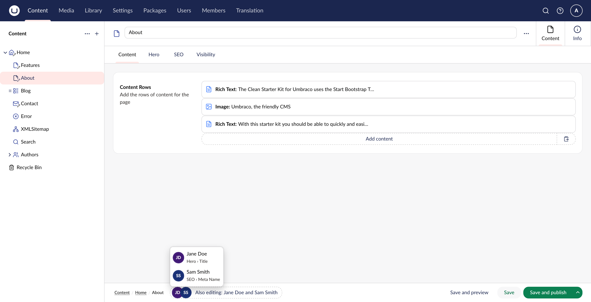
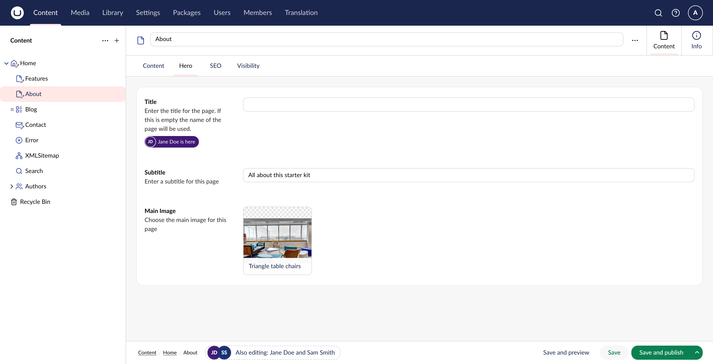
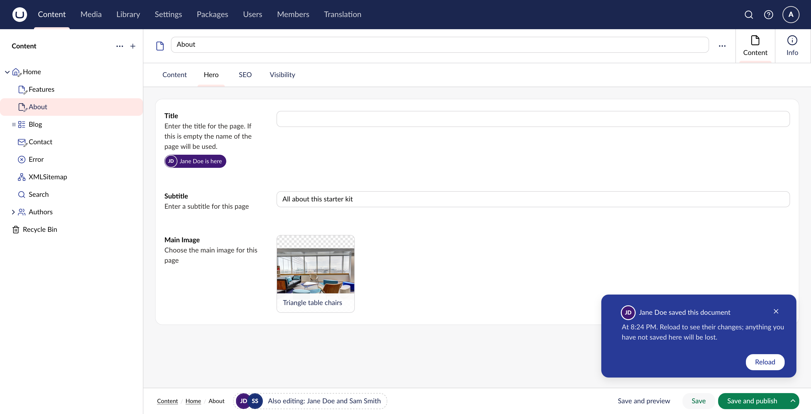

# WhoIsHere

[](https://www.nuget.org/packages/Umbraco.Community.WhoIsHere/)
[](https://www.nuget.org/packages/Umbraco.Community.WhoIsHere)
[](../LICENSE)

Shows, live on the document edit screen, which other backoffice users have the same document open. It is a soft lock: it warns, and it never blocks editing or saving.

- Each editor appears as an avatar in their own colour in the workspace footer, with "Also editing: Jane and Sam" beside it. Clicking it (or Enter) lists everyone along with the field each is in.
- The field each editor is in gets a chip in their colour under its label ("Jane Doe is here"). This works inside blocks too: the block list gets an outlined chip, "Jane Doe in Blog Articles › Page Size".
- Everything updates in real time over SignalR.
- If someone else saves the document while you have it open, you get a notice like "Saved by Jane at 11:42" with a Reload button.

| Who else is editing | Field highlighting | Save notice |
|---|---|---|
|  |  |  |

Targets **Umbraco 18** (.NET 10).

## Install

```bash
dotnet add package Umbraco.Community.WhoIsHere
```

No other steps are needed. A composer registers the hub, the presence store and the background sweeper, and the backoffice picks up the client from `App_Plugins/WhoIsHere`.

## Configuration

Everything is optional. Defaults:

```json
{
  "WhoIsHere": {
    "Enabled": true,
    "HeartbeatSeconds": 20,
    "TimeoutSeconds": 60
  }
}
```

| Setting | Meaning |
|---|---|
| `Enabled` | `false` skips registration entirely. The hub is not mapped, and the client quietly shows nothing. |
| `HeartbeatSeconds` | How often each open document tells the server it is still there. The client reads this value from the server, so you only set it in one place. |
| `TimeoutSeconds` | How long a presence can go without a heartbeat before it is dropped. This only matters for clients that vanish without disconnecting, such as a frozen tab or a sleeping laptop. Closing a tab normally clears the presence within a second. |

The sweeper runs every `TimeoutSeconds / 4`, so a dead client lingers for up to 25% longer than the timeout. With the defaults that is 60–75 seconds.

## How it works

```
Browser tab                                      Server
───────────                                      ──────
WhoIsHere.GlobalContext.Connection  ── Join / Leave / Heartbeat ──▶  WhoIsHereHub (/umbraco/whoishere-hub)
  one HubConnection per tab           ◀── PresenceChanged ─────────     │  authorises: document exists + Browse permission
  ref-counts open documents                                             ▼
  heartbeats, rejoins after reconnect                                IPresenceStore (in memory by default)
        ▲                                                               ▲
WhoIsHere.WorkspaceContext.Presence  (one per document workspace)    PresenceSweeper (drops silent clients)
        ▲
whoishere-presence-indicator  (workspace footer app)

WhoIsHere.WorkspaceContext.SaveConflict ◀── Umbraco's own server events (serverEventHub, "Umbraco:CMS:Document"/"Updated")
                                         ──▶ document audit log (who saved, when)
```

- **Presence is tracked per connection and shown per user.** Two tabs from the same user count as one person, and that user stays listed until both tabs have gone. The current user never sees themselves.
- **Authorization.** The hub uses the same `BackOfficeAccess` policy as Umbraco's own hubs. `Join` also checks that the key is a real document and that the user has Browse permission on it, which is the check Umbraco makes before letting a user open a document. Umbraco's permission check passes keys it cannot find, so the existence check is what stops a user joining groups for made-up keys.
- **Leaving.** Presence clears when the workspace closes or switches to another document, when the user logs out, and on `pagehide` (tab closed, navigated away, or put into the back/forward cache, after which it is restored on `pageshow`). If none of those fire, the heartbeat timeout clears it.
- **Reconnects.** SignalR reconnects automatically. A reconnected client gets a new connection id, so the client rejoins every open document. If the server has forgotten a presence (for example after a timeout or a restart), the heartbeat returns `false` and the client rejoins.
- **Colours** are derived on the server from the user's key, so they are stable across sessions and identical on every client. They are dark enough for white initials to meet WCAG AA contrast (4.5:1) on every hue, which a unit test checks.

### Field highlighting

`WhoIsHere.PropertyContext.Field` is a `propertyContext` controller attached to every property (`umb-property`) in the backoffice. In a document workspace it does two jobs:

- **Reports focus.** When focus enters a field, it tells the server which field this tab is in (`SetLocation`, debounced by 150ms). When focus leaves, it waits 2 seconds before clearing, so clicking a toolbar or opening a picker doesn't flicker the highlight. Switching to another window keeps the location, because the user hasn't left the field.
- **Shows other editors.** It adds a chip under the field's label in the editor's colour: filled when someone is in the field itself, outlined when someone is inside one of its blocks.

**Field identity.** A field is identified by `{owner key}/{property alias}/{variant}`, where the owner is the document, or the block content or settings element the value belongs to. Block keys are GUIDs, so the id is unique across the whole document and identical on every client. Umbraco's own `dataPath` was the obvious candidate, but it is relative to the nearest block, so it isn't unique.

**Nesting.** Each field controller provides itself as a context to the fields inside it. That works through inline blocks and, through the modal's context proxy, through blocks opened in a modal. A nested field can therefore send its ancestors along with its location, and the block list around it can show that someone is inside.

**Labels.** The footer popover shows where each editor is, starting from the tab: "Hero › Title", or "Content › Content Rows › Blog Articles › Page Size" for a field in a block. The tab comes from the document type's structure. On a document type that has groups but no tabs, the group's name is used instead.

**Self-exclusion.** The current user never sees their own highlight. If a user has the document open in two tabs, others see the field from whichever tab moved most recently.

**Registration.** A `propertyContext` only applies to the property editor UIs it lists by alias, with no wildcard. A `backofficeEntryPoint` therefore watches the extension registry and re-registers the controller for every property editor, including editors from other packages.

### Save-conflict notice

Umbraco already broadcasts an `Updated` server event whenever a document is saved, so WhoIsHere listens for that rather than running its own plumbing. The event says which document changed but not who changed it. WhoIsHere fills that in from the document's audit log:

- If the latest entry was written by the current user, no notice is shown. That covers saves from this tab and from the same user's other tabs.
- Otherwise a notification stays on screen until dismissed: "Jane Doe saved this document", the time, and a warning that reloading discards unsaved edits. It shows Jane's avatar in her presence colour and a Reload button, which reloads the workspace. It uses Umbraco's standard info colour rather than warning yellow, because nothing is blocked. It is its own element, `whoishere-save-conflict-notification`, because Umbraco's default notification layout renders the message with `white-space: pre-line`, which turns template formatting into blank lines.

The notice never blocks anything. If you save without reloading, your save wins, exactly as it would without the package.

## Placement: why the workspace footer

v18 offers four places to put this:

| Option | Verdict |
|---|---|
| **Workspace footer app** (`workspaceFooterApp`) | **Chosen.** Visible on every view of the document (Content, Info, and any custom views), sits next to the breadcrumb where editors already look for context, and is designed to hold small status widgets. |
| Workspace action (`workspaceAction`) | Rejected. Actions are the buttons on the right of the footer (Save, Save and publish). Presence is information, not an action, and it would crowd those buttons. |
| Workspace info app (`workspaceInfoApp`) | Rejected. Only visible on the Info tab, so editors on the Content tab, which is where conflicts happen, would never see it. |
| Workspace view (`workspaceView`) | Rejected. A separate tab is the opposite of glanceable. |

## Accessibility

- The avatars sit inside a single button whose accessible name is the full summary ("Also editing: Jane Doe and Sam Smith"). One tab stop reaches it, and Enter or Space opens a popover listing every editor by name.
- Each avatar also has a `title` for mouse users.
- Past three editors, the group shows `+N`. The popover still lists everyone.

## Load balancing

v1 is single-server. `InMemoryPresenceStore` holds presence in process memory, so in a load-balanced backoffice each server only knows about the connections it hosts.

A load-balanced setup needs two things:

1. **A SignalR backplane**, such as `Microsoft.AspNetCore.SignalR.StackExchangeRedis` or Azure SignalR Service, so that group broadcasts reach clients connected to other servers. Umbraco's own load-balanced backoffice needs one for its server events anyway.
2. **A shared `IPresenceStore`**, for example one backed by Redis hashes with per-entry expiry. The interface is async for this reason. Register your implementation before WhoIsHere's composer runs, or replace the registration afterwards. The composer uses `TryAddSingleton`, so an earlier registration wins.

With a shared store, run the sweeper on a single server, or make `RemoveExpiredAsync` atomic in the store, so that expiry broadcasts aren't duplicated.

A Redis backplane is **not included**. A Redis client is a heavy dependency for a feature most sites won't use. It would sit better in a separate `Umbraco.Community.WhoIsHere.Redis` package that provides both the backplane registration and the store.

If you use Azure SignalR without sticky sessions, set Umbraco's `Umbraco:CMS:SignalR:ClientShouldSkipNegotiation`. WhoIsHere honours it the same way Umbraco's hubs do: WebSockets only, with negotiation skipped.

## Design decisions

- **Hub path:** `/umbraco/whoishere-hub`. It has to live under `/umbraco/` because Umbraco's OpenIddict validation ignores requests outside that path. WhoIsHere registers its own hub (`MapHub` from an `UmbracoPipelineFilter`) rather than piggybacking on Umbraco's hubs. Those hubs have fixed contracts, and their internals (`IServerEventRouter`, user groups) are not designed for extension.
- **Per-culture/variant presence:** v1 treats the document as a whole. A natural extension is to join `doc:{key}:{culture}` alongside the document group, so the indicator can show who is on which language.
- **Field-level presence:** see [Field highlighting](#field-highlighting). It shows where people are, not what they are typing. There is no co-editing or merging.
- **Idle state (tab hidden):** not implemented. It would need a `visibilitychange` listener and an extra `idle` flag on `PresenceUser`. It would be easy to add, but it doubles the broadcast traffic for a nice-to-have.

## Notes on the Umbraco 18 APIs

Everything below was checked against the `@umbraco-cms/backoffice` 18.2.1 typings and source:

- **Auth is cookie-based.** The backoffice keeps its access token in an httpOnly cookie. `UMB_AUTH_CONTEXT.getLatestToken()` returns the placeholder `[redacted]`, and the server swaps it for the cookie's token. That placeholder is what goes into `accessTokenFactory`. There is no real token to send.
- **SignalR is not a separate npm dependency.** The backoffice ships it as `@umbraco-cms/backoffice/external/signalr`, so the package reuses that copy instead of bundling `@microsoft/signalr`.
- **Server events** come from `UMB_MANAGEMENT_API_SERVER_EVENT_CONTEXT` (`byEventSourcesAndEventTypes`), with source `Umbraco:CMS:Document` and type `Updated`. They carry only the document key, so the save-conflict notice also reads the audit log.
- **Confirmed names:** workspace alias `Umb.Workspace.Document`, condition `Umb.Condition.WorkspaceAlias`, `UMB_DOCUMENT_WORKSPACE_CONTEXT` (`unique`, `isNew`, `reload()`), `UMB_CURRENT_USER_CONTEXT.unique`, and the `globalContext`, `workspaceContext` and `workspaceFooterApp` extension types.
- **New documents** (not yet saved) don't register presence, because they don't exist on the server yet. Presence starts as soon as the document is first saved.

## Known limitations

- Single server only; see [Load balancing](#load-balancing).
- Presence is per document, not per culture or variant.
- If two people save within moments of each other, the latest audit entry may belong to the other save, so the notice can name the wrong person or be skipped.
- A user who loses access to a document while it is open keeps receiving that document's presence list (names and avatars only) until they leave it or reconnect.
- Umbraco has no extension point for decorating a property, so field highlighting appends a chip to the `description` slot of the property's `umb-property-layout`. That is a plain DOM addition that Umbraco's rendering leaves alone in 18.x, but a change to that markup in a later version could break the highlighting. Presence and the footer would keep working.
- For a block opened in a modal, the block's label comes from the modal title ("Edit Blog Articles") minus its localized "Edit"/"Add" prefix. In v18 there is no public accessor for the label alone. If the prefix doesn't match, the block's element type name is used instead.
- Field highlighting follows keyboard focus. Fields that never take focus, such as a media picker that's only been looked at, don't report a location.
- Only documents are covered. The hub and store are keyed by entity key, so adding media means adding another authorization check and another workspace condition.

## Development

```
src/
  Umbraco.Community.WhoIsHere/            # Razor class library, NuGet-packable
    Client/                               # TypeScript + Lit source, built by Vite into ../wwwroot/App_Plugins/WhoIsHere
  Umbraco.Community.WhoIsHere.TestSite/   # Umbraco 18 site (SQLite, unattended install) referencing the package
  Umbraco.Community.WhoIsHere.Tests/      # Store, colour and sweeper unit tests (xUnit v3)
```

The layout follows the `umbraco-extension` template inside the community package-starter repository structure. See [CONTRIBUTING.md](CONTRIBUTING.md) for build and test commands.

The release workflow (`.github/workflows/release.yml`) runs on a version tag such as `0.1.0`. It rebuilds the client, runs the tests, packs the package and pushes it to NuGet using [trusted publishing](https://learn.microsoft.com/nuget/nuget-org/trusted-publishing), so no API key is stored in the repository.

Tests use Microsoft.Testing.Platform, which the root `global.json` opts into because .NET 10 no longer runs xUnit v3 through VSTest.
